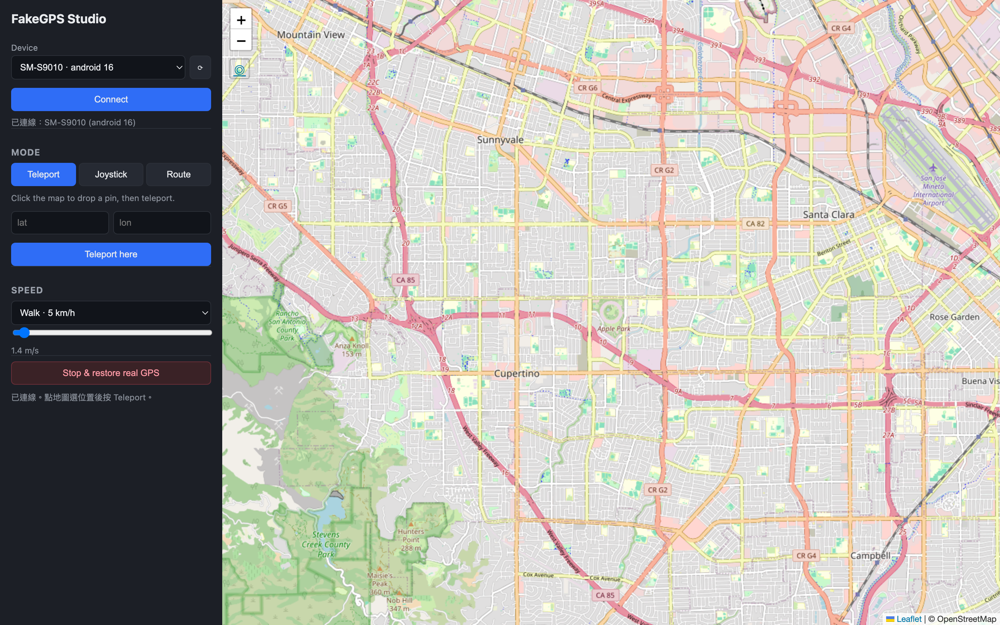

# FakeGPS Studio 操作手冊

一個桌面工具，可在 **未越獄的 iOS（17+）** 與 **未 root 的 Android** 裝置上
模擬 GPS 定位，並透過地圖介面操作。功能對標 iAnyGo：瞬移（Teleport）、
搖桿（Joystick）、兩點／多點路線、GPX 匯入、可調速度，並可選**擬真移動**
（起步加速、轉彎／終點減速、GPS 抖動）。



> **僅供合法用途。** 定位模擬是標準的開發／測試功能（等同 Xcode 的
> *Simulate Location* 與 Android 開發者選項的 *模擬位置*）。請用於測試你
> 擁有或獲授權的 App、除錯定位功能與開發。用於規避反作弊、詐騙或違反服務
> 條款的後果由使用者自行承擔。

---

## 目錄
1. [運作原理（免越獄／免 root）](#運作原理免越獄免-root)
2. [系統需求](#系統需求)
3. [安裝](#安裝)
4. [快速開始（Demo 模式，免實機）](#快速開始demo-模式免實機)
5. [介面操作說明](#介面操作說明)
6. [接 iOS 實機（17+）](#接-ios-實機17)
7. [接 Android 實機](#接-android-實機)
8. [常見問題與排錯](#常見問題與排錯)
9. [專案結構](#專案結構)

---

## 運作原理（免越獄／免 root）

本工具**不修改手機系統**，而是從電腦端驅動各平台「官方提供」的定位功能。

- **iOS 17+** — 使用 Apple 開發者用的「模擬定位」能力（與 Xcode 的
  *Simulate Location* 相同）。iOS 17 起此功能改走 RemoteXPC 隧道
  （RemoteServiceDiscovery），本工具透過
  [`pymobiledevice3`](https://github.com/doronz88/pymobiledevice3) 連線、
  自動掛載 Developer Disk Image，並保持一條持續連線串流座標，讓搖桿與
  路線播放即時更新。
- **Android** — 使用內建的「模擬位置」開發者選項。隨附的 companion App
  會註冊為測試定位提供者（`addTestProvider` / `setTestProviderLocation`），
  你在開發者選項選它一次之後，桌面端即可透過 ADB 串流座標。免 root。
  App 內建**心跳**：每秒以最新時間戳重送目前座標，避免單筆 fix 過期後
  fused provider 退回真實 GPS（定位「飄回原點」）。

> **版本注意：** iOS 17+（含 iOS 26）必須使用 **pymobiledevice3 9.x 以上**。
> 9.x 的 tunneld / 掛載 / DVT 定位 API 全為 **async**，本專案的 iOS driver
> 因此在內部跑一條專屬事件迴圈執行緒，對外仍提供同步介面。請勿降到 4.x
> （會找不到 `ipsw_parser.img4` 且不支援新機）。

### 已驗證狀態

| 平台 | 狀態 |
|------|------|
| iOS 實機（iPhone 17,1 / iOS 26.5）| ✅ teleport、joystick、route 實機驗證通過 |
| Android 實機（SM-S9010 / Android 16）| ✅ teleport、route 串流、clear 還原實機驗證通過；mock 同時傳播到 `gps` 與 `fused` provider |

---

## 系統需求

| 項目 | 需求 |
|------|------|
| 作業系統 | macOS（本手冊以 macOS 為例）|
| Python | 3.10+（開發機實測 3.12）|
| iOS 實機 | iPhone iOS 17+，已用本電腦「信任」過 |
| iOS 隧道 | 需 `sudo`（建立虛擬網路介面）|
| Android 實機 | 已開啟 USB 偵錯；需 `adb`（Android platform-tools）|
| 建置 companion App | Android SDK + JDK 17+（已隨專案產生 Gradle wrapper）|

---

## 安裝

```bash
cd "iOS Fake GPS/backend"
python3 -m venv .venv
source .venv/bin/activate
pip install -r requirements.txt        # 含 pymobiledevice3、pywebview
```

> 只想先試 UI（Demo 模式）的話，最少只需
> `pip install fastapi "uvicorn[standard]" httpx websockets`。

本專案已預先完成：venv、完整套件、Android Gradle wrapper 與 `app-debug.apk`
建置驗證。

---

## 快速開始（Demo 模式，免實機）

Demo 模式提供兩台假裝置，可在沒有任何手機的情況下操作完整 UI 與路線引擎。

```bash
cd "iOS Fake GPS"
source backend/.venv/bin/activate
FAKEGPS_DEMO=1 python3 run.py            # 開啟原生桌面視窗
# 或瀏覽器模式：
FAKEGPS_DEMO=1 uvicorn backend.app:app --port 8765
# 然後打開 http://127.0.0.1:8765
```

Demo driver 只會記錄並輸出座標、不碰硬體，但整個介面與運算流程與接實機時完全一致。

常用指令：
- 看即時記錄：`tail -f /tmp/fakegps.log`（用背景啟動時）
- 停止伺服器：`pkill -f "uvicorn backend.app:app"`

---

## 介面操作說明

左側為控制面板，右側為地圖。

> 開啟網頁時會自動用瀏覽器定位把地圖移到你目前位置；可隨時按地圖左上角的
> **◎** 鈕重新定位（僅移動視野，不會改手機定位）。

### 1. 連線裝置
- 從 **Device** 下拉選單選擇裝置，按 **⟳** 重新掃描。
- 按 **Connect** 連線；下方會顯示已連線資訊。
- **只有一台裝置時會自動連線**，不需手動按 Connect。

### 2. 模式分頁

| 模式 | 操作 |
|------|------|
| **Teleport（瞬移）** | 在地圖上點一下放下圖釘，或手動輸入經緯度，按 **Teleport here** 立即跳到該點。 |
| **Joystick（搖桿）** | **在地圖點一下即設為起點**（也可先用 Teleport）。接著點方向鈕，或用 **方向鍵 ↑↓←→ / WASD**；**按住**會持續移動（每 0.5 秒一步），放開即停。同時按兩鍵可走斜角（例如 W+D = 東北）。按 ■ 停止。 |
| **Route（路線）** | 在地圖點 2 個以上航點（或用下方上傳 `.gpx`），勾選 **Loop** 可循環往返，按 **Start route** 開始沿路線移動；播放中按 **Stop** 停止。勾選 **擬真移動** 會套用起步加速、轉彎／終點減速、速度微抖；可再設 **GPS 抖動 (m)** 模擬定位雜訊，讓軌跡更接近真人。 |

### 3. 速度（Speed）
- 預設下拉：走路 5 km/h、跑步 12 km/h、騎車 21 km/h、開車 50 km/h。
- 或用拉桿微調（0.5–30 m/s）。速度決定搖桿每步與路線播放的前進距離。

### 4. 還原
- **Stop & restore real GPS** — 停止模擬並還原裝置真實 GPS。

---

## 接 iOS 實機（17+）

1. 用 USB 連接 iPhone，並在手機上點「信任這台電腦」。
2. **另開一個終端機**啟動隧道並保持執行（需 sudo）：
   ```bash
   cd "iOS Fake GPS"
   source backend/.venv/bin/activate
   sudo python3 -m pymobiledevice3 remote tunneld
   ```
3. **回到原終端機**，以**非 Demo** 模式啟動：
   ```bash
   source backend/.venv/bin/activate
   python3 run.py
   ```
4. 在 UI 按 **⟳** 掃描 → 選到你的 iPhone → **Connect** → 即可瞬移／搖桿／路線。

> 首次連線會自動下載並掛載 Developer Disk Image，可能需數十秒。
> 也可先手動掛載：`python3 -m pymobiledevice3 mounter auto-mount`。

iOS ≤ 16 會自動走舊版 DDI + `simulatelocation` 路徑，不需隧道。

---

## 接 Android 實機

1. 建置並安裝 companion App：
   ```bash
   cd "iOS Fake GPS/android-companion"
   JAVA_HOME=$(/usr/libexec/java_home) ./gradlew installDebug
   ```
   （或用 Android Studio 開啟此資料夾後直接 Run。）
2. 手機上一次性設定：
   - 開啟 **開發者選項**（連點「版本號碼」7 下）。
   - **開發者選項 → 選擇模擬位置應用程式 → FakeGPS Companion**。
   - 開啟 App 一次讓前景服務啟動，必要時授予定位權限。

   > **捷徑（免手動點開發者選項）：** 安裝後可直接用 adb 授權模擬位置：
   > ```bash
   > adb install -r -g app/build/outputs/apk/debug/app-debug.apk
   > adb shell appops set com.fakegps.companion android:mock_location allow
   > ```
   > 驗證落地：`adb shell dumpsys location | grep "last location=Location\[fused"`
   > 應看到帶 `mock` 標記的座標（多數 App 讀 `fused` provider）。
3. 桌面端以非 Demo 模式啟動（同上 `python3 run.py`），掃描即可看到 Android 裝置。

控制原理：桌面端用 `adb shell am broadcast` 送
`SET_LOCATION` / `CLEAR_LOCATION` 廣播，App 收到後呼叫
`setTestProviderLocation()`。

---

## 常見問題與排錯

**找不到 iOS 裝置 / 連線失敗**
- 確認隧道（`sudo ... remote tunneld`）正在另一終端機執行中。
- 確認手機已「信任」此電腦、螢幕已解鎖。
- 狀態列會顯示**真正的 iOS 錯誤**（含啟動 tunneld / 掛載 DDI 等提示）。
  早期版本會誤報成「Android device ... not found」——那是後端依序試
  iOS→Android 時把後者的錯誤蓋掉了，現已改為**依平台路由**，不會再發生。

**連線後再次操作卻 409 / 連線變慢或卡住**
- iOS 同一時間只能有一個定位模擬 session。`select` 已改為**冪等**：重複連
  同一台是 no-op，不會反覆拆掉／重建 session。若仍卡住，重啟伺服器即可。

**`adb not found`**
- 安裝 Android platform-tools，或把
  `~/Library/Android/sdk/platform-tools` 加進 `PATH`。

**Android 顯示「不允許模擬位置」**
- 回開發者選項，確認「選擇模擬位置應用程式」選的是 FakeGPS Companion。

**Android 定位一下子又飄回原點**
- Android 的 `setTestProviderLocation` 是一次性的，單筆 fix 過幾秒就「過期」，
  fused provider 會退回真實 GPS。companion 服務內建**心跳**：每秒用最新時間戳
  重送最後座標壓住它（在手機端自行維持，桌面端沒在送也不會飄）。若仍會飄，
  代表你裝的是舊版 APK——重新 `./gradlew :app:assembleDebug` 並
  `adb install -r -g ...` 即可。

**桌面視窗開不起來（pywebview）**
- `run.py` 會自動退回瀏覽器模式並印出網址，直接用瀏覽器開即可。

**改了前端沒生效**
- 前端是靜態檔，重新整理瀏覽器即可；不需重啟伺服器。
- 改了 `backend/` 的 Python 才需要重啟伺服器（或用 `--reload` 啟動）。

**地圖沒定位到我目前位置**
- 開啟網頁時瀏覽器會請求定位權限，請按「允許」。`127.0.0.1` 屬安全來源，
  瀏覽器允許定位。可隨時按地圖左上角的 **◎** 鈕重新定位。
- 此定位只移動地圖視野，**不會**把座標推到手機；要改手機定位仍需按
  Teleport 或在 Joystick 模式點地圖設起點。

**companion App 建置失敗**
- 確認 `android-companion/local.properties` 的 `sdk.dir` 指向你的 SDK，
  且已安裝 JDK 17+。專案已釘 Gradle 8.9 / AGP 8.5.2。

---

## 專案結構

```
backend/
  routing.py         路線數學：大圓內插、速度播放、GPX 解析
  devices/ios.py     iOS 17+ 驅動（pymobiledevice3；含 ≤16 舊版退回）
  devices/android.py Android 驅動（adb + companion App）
  devices/demo.py    Demo 模式假裝置（FAKEGPS_DEMO=1）
  app.py             FastAPI + WebSocket 控制層，路線／搖桿播放引擎
frontend/            Leaflet 地圖 UI（瞬移、搖桿、路線、GPX、速度）
run.py               啟動伺服器並開啟原生桌面視窗（pywebview）
android-companion/   Kotlin 模擬定位 App（service + 廣播接收器 + Gradle）
```

### API 速查（供進階整合）

| 方法 | 路徑 | 說明 |
|------|------|------|
| GET | `/api/devices` | 列出裝置 |
| POST | `/api/select` | 選擇裝置 `{udid}` |
| POST | `/api/teleport` | 瞬移 `{lat, lon}` |
| POST | `/api/joystick` | 搖桿一步 `{heading, speed}` |
| POST | `/api/route` | 開始路線 `{points[], speed, loop, realistic, jitter_m}` |
| POST | `/api/stop` | 停止播放 |
| POST | `/api/clear` | 清除模擬、還原真實 GPS |
| POST | `/api/gpx` | 解析 GPX `{gpx}` → 座標陣列 |
| WS | `/ws` | 即時位置／狀態推播 |
